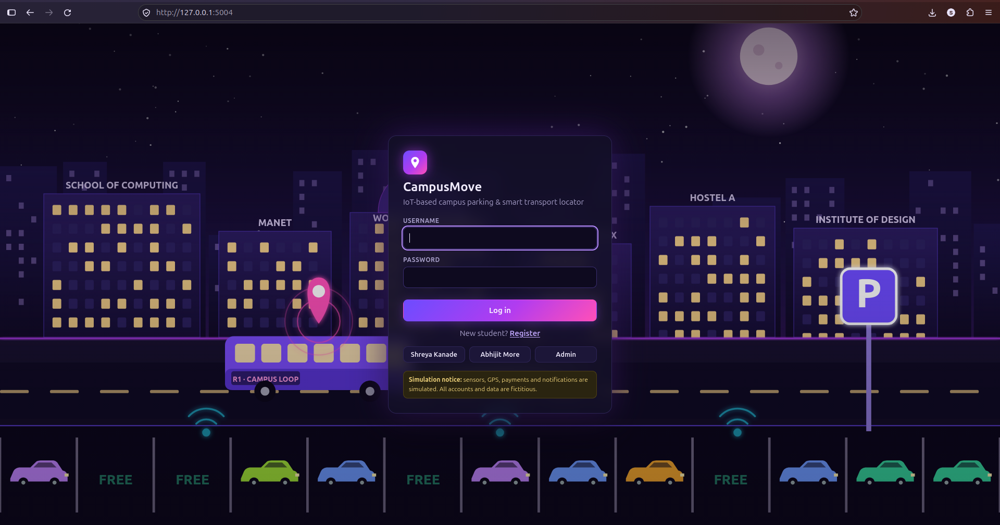
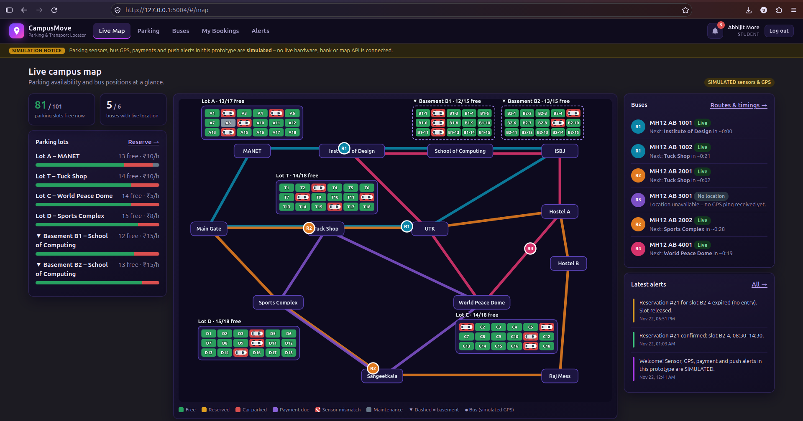
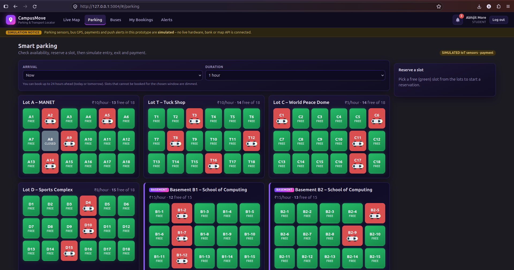
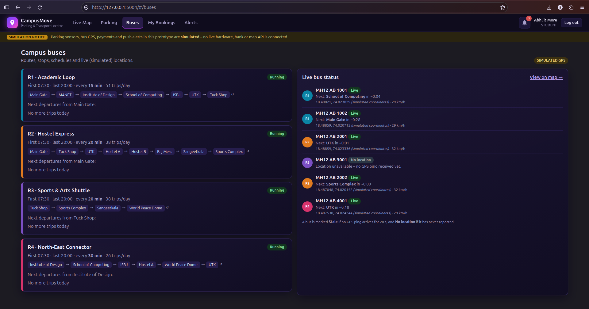
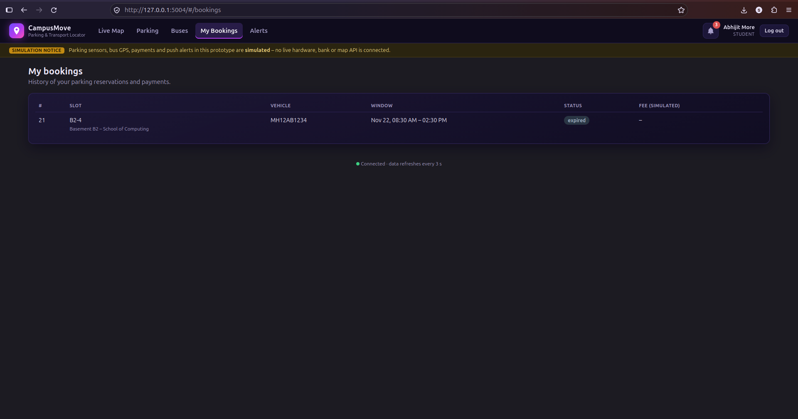
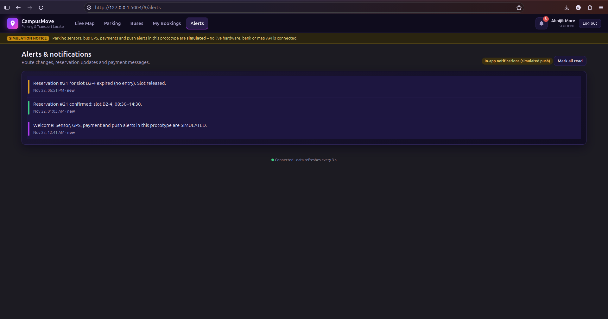
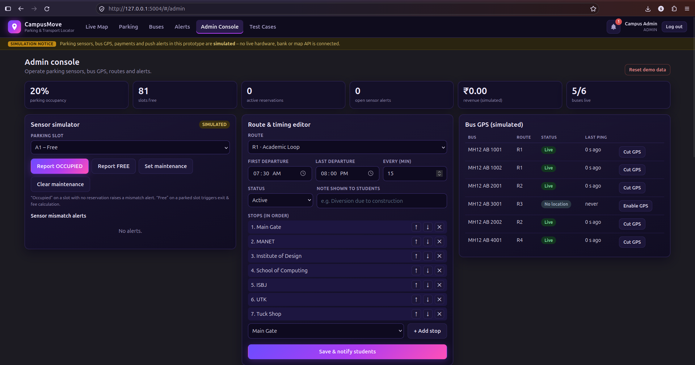
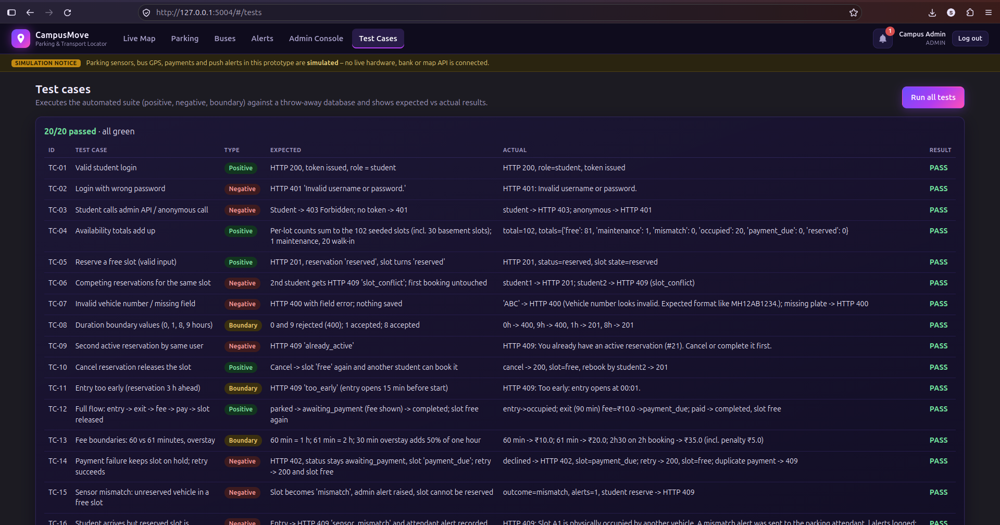

<div align="center">

# CampusMove

### Smart Parking & Campus Transportation Management System

A web-based mobility platform that simplifies parking management and campus transportation through simulated IoT and GPS technology.

</div>

---

## Overview

CampusMove is a web application designed to make campus mobility more organized and convenient. It brings parking management and shuttle transportation together in one platform.

Users can check parking availability, reserve parking spaces, monitor shuttle locations, view estimated arrival times, and receive transportation updates. An administrative dashboard provides tools to manage parking operations, monitor system activity, and maintain transportation routes.

The application demonstrates real-world IoT-based workflows using simulated sensor data, GPS coordinates, and payment processing, without requiring physical hardware or external payment services.

## Key Features

### 1. Smart Parking Management
- View parking availability across multiple parking zones.
- Check individual parking slot statuses in real time within the application.
- Reserve parking spaces for immediate or scheduled arrival.
- Prevent overlapping reservations and double bookings.
- Simulate vehicle entry and exit through sensor controls.
- Automatically update slot availability after reservation cancellation or successful payment.

### 2. Campus Transportation Tracking
- View available shuttle routes, stops, and schedules.
- Track simulated shuttle bus locations on an interactive map.
- Monitor bus speed, next stop, and estimated arrival time.
- Receive alerts about route and schedule changes.
- Detect stale or unavailable location data.

### 3. Reservation & Payment System
- Book parking slots for selected durations.
- Calculate parking fees based on usage.
- Apply additional charges for overstaying.
- Simulate UPI, card, and wallet payments.
- Test payment failures through a simulation control.

### 4. Administrative Dashboard
- Monitor parking activity and system statistics.
- Manage parking sensors and simulate sensor activity.
- Identify parking mismatches and maintenance requirements.
- Manage shuttle routes, schedules, and transportation updates.
- View and manage system alerts.
- Execute application test cases through the dashboard.

### 5. Authentication & Data Management
- User authentication with role-based access.
- Separate user and administrator capabilities.
- REST API-based communication between frontend and backend.
- SQLite database for persistent application data.
- Input validation and reservation conflict handling.

## Screenshots

### Login

<p align="center">
  
</p>

### Live Campus Map

<p align="center">
  
</p>

### Parking & Transportation

<p align="center">
  
  
</p>

### User Dashboard

<p align="center">
  
  
</p>

### Administration & Testing

<p align="center">
  
  
</p>

## Technology Stack

### Backend


### Frontend


### Tools & Testing


## Application Architecture

CampusMove follows a client-server architecture in which the frontend communicates with a Flask backend through RESTful APIs.

### Architecture Overview

```text
             ┌──────────────────────────┐
             │      Web Browser         │
             │                          │
             │   HTML, CSS, JavaScript  │
             │   Interactive Dashboard  │
             └────────────┬─────────────┘
                          │
                    REST API / JSON
                          │
             ┌────────────▼─────────────┐
             │      Flask Backend       │
             │                          │
             │  Authentication          │
             │  Parking Management      │
             │  Transportation Tracking │
             │  Administration          │
             └────────────┬─────────────┘
                          │
                    Database Queries
                          │
             ┌────────────▼─────────────┐
             │      SQLite Database     │
             │                          │
             │  Users & Reservations    │
             │  Parking Information     │
             │  Routes & Schedules      │
             │  Application Data        │
             └──────────────────────────┘
```

### Core Components

| Component | Description |
|---|---|
| Frontend | A JavaScript-based single-page application with HTML, CSS, and SVG interfaces. |
| Backend | Flask handles application logic, authentication, reservations, transportation, and administrative operations. |
| REST API | JSON-based communication between the frontend and backend using Bearer token authentication. |
| Database | SQLite stores application data and maintains persistence across sessions. |
| Simulation Engine | Simulates parking sensor activity, shuttle GPS movement, and payment workflows. |
| Testing | Python's `unittest` framework supports automated application testing. |

### How It Works

1. Users interact with the application through the browser.
2. The frontend sends requests to the Flask backend through REST APIs.
3. The backend validates requests and processes application logic.
4. SQLite handles data storage and retrieval.
5. The frontend displays updated information to the user.

The frontend periodically requests updated information to keep parking availability and simulated shuttle locations current.

## Project Structure

```text
CampusMove/
│
├── campus/
│   ├── auth.py             # Authentication and user management
│   ├── parking.py          # Parking reservations and sensor simulation
│   ├── transport.py        # Shuttle routes and GPS simulation
│   ├── admin.py            # Administrative operations
│   ├── db.py               # Database operations
│   └── selftests.py        # Built-in application tests
│
├── docs/                   # Project documentation
│
├── static/                 # Frontend assets
│
├── tests/                  # Automated test suite
│
├── .gitignore              # Git exclusion rules
├── requirements.txt        # Python dependencies
├── run.py                  # Application entry point
└── README.md               # Project documentation
```

### Directory Overview

- **`campus/`** – Contains the core backend modules and application logic.
- **`docs/`** – Stores project-related documentation.
- **`static/`** – Contains frontend files, stylesheets, scripts, and visual assets.
- **`tests/`** – Contains automated tests.
- **`run.py`** – Starts the Flask application.
- **`requirements.txt`** – Lists the Python dependencies required to run the project.

## Installation & Setup

Follow these steps to run CampusMove on your local machine.

### Prerequisites

Make sure the following are installed:

- Python 3.10 or later
- Git
- pip (Python package manager)

### 1. Clone the Repository

```bash
git clone https://github.com/BugFreeShreya404/CampusMove.git
```

### 2. Navigate to the Project Directory

```bash
cd CampusMove
```

### 3. Create a Virtual Environment

```bash
python -m venv venv
```

Activate it:

**Linux / macOS**
```bash
source venv/bin/activate
```

**Windows**
```bash
venv\Scripts\activate
```

### 4. Install Dependencies

```bash
pip install -r requirements.txt
```

### 5. Run the Application

```bash
python run.py
```

### 6. Open in Browser

Once the server starts, visit:

```text
http://127.0.0.1:5004
```

The application will initialize its SQLite database automatically when required.

## Demo Credentials

CampusMove includes preconfigured demo accounts to explore the application's different roles.

| Role | Login | Password |
|---|---|---|
| User | Shreya Kanade | `shreya123` |
| User | Abhijit More | `abhijit123` |
| Administrator | `admin` | `admin123` |

**Note:** These credentials are intended for local demonstration purposes only. All accounts and associated data are fictitious.

## Testing

CampusMove includes automated test cases to verify core application functionality, including authentication, parking reservations, payment processing, transportation operations, and administrative workflows.

### Run Built-in Tests

```bash
python -m campus.selftests
```

### Run Unit Tests

```bash
python -m unittest discover tests -v
```

### Run Tests Through the Application

You can also execute the available test cases directly from the application:

1. Log in using the administrator account.
2. Navigate to **Admin → Test Cases**.
3. Select **Run All Tests**.
4. Review the test results displayed in the dashboard.

## Simulation & Implementation Details

CampusMove demonstrates IoT-based parking and transportation workflows through software simulations.

The application does not require physical sensors, GPS hardware, external map services, or real payment integrations.

| Feature | Implementation |
|---|---|
| Parking Sensors | Software-based simulation of vehicle entry, exit, and slot occupancy. |
| Shuttle GPS | Simulated GPS coordinates and movement along predefined routes. |
| Live Updates | Periodic frontend requests to retrieve updated application data. |
| Payment Processing | Simulated UPI, card, and wallet transactions. |
| Notifications | In-application alerts for transportation and parking updates. |
| Database | Local SQLite storage with automatically initialized application data. |

### Parking Fee Calculation

Parking charges are calculated based on the duration of vehicle occupancy.

- Minimum billing duration: 1 hour.
- Partial hours are rounded up to the next full hour.
- Additional overstay charges apply when a vehicle exceeds its reserved duration.
- The parking slot is released after successful payment.

All transactions and user information are fictitious and intended for demonstration purposes.

## Future Improvements

Some possible enhancements for future versions include:

- Integration with physical IoT parking sensors.
- Real-time GPS tracking using external location services.
- Integration with secure payment gateways.
- Push notifications for important parking and transportation updates.
- Advanced analytics and usage reports.
- Mobile-friendly application or dedicated mobile app.

## Author

**Shreya Kanade**

B.Tech Computer Science & Engineering

- GitHub: [@BugFreeShreya404](https://github.com/BugFreeShreya404)
- Project Repository: [CampusMove](https://github.com/BugFreeShreya404/CampusMove)

---

<p align="center">
  If you find this project interesting, consider giving it a ⭐ on GitHub!
</p>

